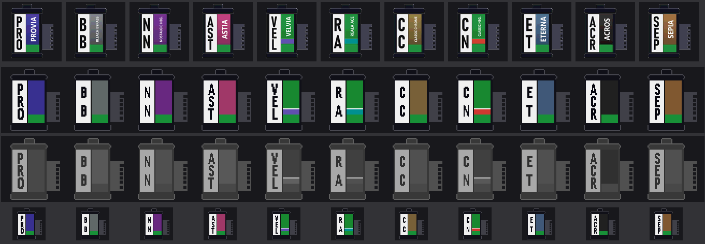
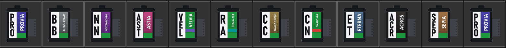

# FAUXJI for the Samsung TL500 (EX1)

**Quality-of-life fixes the TL500 should have shipped with: an exposure system that stops fighting you, unlocked menus, auto-ISO in
manual and a shutter that stays usable when you zoom. Plus a set of optional Fuji-style extras.**

It is a **build tool**, not a firmware download: it patches *your own* copy of Samsung's official firmware on your own computer.
Nothing of Samsung's is included in this repository.

> **Not affiliated with Samsung or Fujifilm.** Fujifilm's film names (PROVIA, Velvia, ACROS, Classic Chrome and so on) are their
> trademarks. They are used here only to say which look each setting imitates.
> **Flash at your own risk.** See [Safety](#safety) first. You are changing the software of a camera that is out of production.

Current version: **TL-F63**, built on firmware **008264** only.

Film camera build (`--film`, see below): **TL-F65t**, same firmware, in development on the `polish` branch.

## The main event: fixes that make the camera better to use

- **Shutter that stays usable, with auto ISO.** In P, A and S the camera keeps a minimum shutter of 1/60 s and raises the ISO (up to 1600)
  instead of slowing down. Stock, it quietly raised the minimum as you zoomed (1/125 s and faster, the zoom hand-shake shift), and the
  flash raised it too: both are gone.
- **Auto-ISO in manual.** Manual mode gets automatic ISO, so you set shutter and aperture and the camera picks the ISO.
- **Highlight-friendly metering.** Metering is biased -0.3 EV in every mode, so skies and lamps blow out less. The exposure scale
  still reads 0.
- **Menus open in P, A, S and M.** In those modes every menu option is available. Stock, some were greyed out depending on the mode.
- **Clear shooting screen.** The film-name pop-up box sits in the top-left corner, sized to fit "Classic Chrome" on one line, and
  stays out of the way in movie mode, where that corner shows the recording timer.
- **Looks work with RAW+JPEG.** The looks Samsung blocked when you shoot RAW+JPEG now work, and Bleach Bypass saves at full size.

## The extras: Fuji-style looks and interface

If you like the Fuji feel, the same build also has these. They come with the fixes for now; a switch to leave them out is the next thing
planned (see Coming up).

- **Film looks.** Eleven Fuji-style looks in the Photo Style slots (PROVIA, ACROS, Classic Chrome, Classic Neg., Velvia, ASTIA, Eterna,
  Sepia and more): colour, tone curves and per-hue colour tuned for this sensor, in live view and in captured JPEGs.
- **FILM SIM button.** The AE-L button menu gets a FILM SIM option that cycles your looks, with a film-canister icon and a name pop-up.
- **Fuji-style interface.** Flat white icons, and Fuji-style menus, shooting screen, mode dial, pop-ups, playback edit screens, boot
  screen, shutter sound and menu names (Image Quality, AE-L Button, Framing Guide and so on).



*The cartridge icons the camera shows for each look (menu size, live view, and unavailable). Drawn for this project from photos of real 35 mm
cartridges. The `--film` build uses them everywhere; the plain build still has the earlier canister artwork.*

## Film camera mode (new in v0.3, experimental)

Build it with `python tools/build_fauxji.py <stock dir> <out dir> --film` (version label TL-F65t). The SCENE spot on the mode dial becomes a
film camera:

- It behaves like P: the 1/60 minimum shutter with auto ISO, open menus, and macro, flash and self-timer on the direction keys.
- The scene picker is a film picker: one cartridge card per look (11 looks), and a twelfth card, **Mystery**: every mystery roll is loaded
  with a surprise look. The camera doesn't show which one (the live view still does, of course); you find out when you develop it.
- Every roll of 36 is its own folder named after the film (PROV001, ACRO002, MYST001 ...) under `FILMS/` on the card, outside DCIM, so
  normal playback never lists them. Rolls are counted per film, and a part-shot roll continues when you pick its film again.
- The counter counts up like a film camera's: it shows the frame you are about to shoot (1 to 36). After every shot the front dial must be
  turned right to wind on (a wind-on icon shows); AE-L starts the next roll when the roll is full (a roll-full icon shows).
- Every photo says what made it: EXIF Make **FAUXJI FILM**, Model **TL500 Classic Chrome** (the film it was shot on, also in P, A, S and
  M), Software the build label. Photo apps that group by camera then group by film.
- Turning the front dial to wind on plays a ratchet click (when the camera's sounds are on).
- Every film photo gets an orange '90s date stamp, `26 11 08` in seven-segment digits, burned into the JPEG like a film camera's date back
  (outside the film camera the Imprint setting works as before).
- The FAUXJI FILM TL500 boot screen (its original text, redrawn).
- No picture review on the camera: PLAY shows a file-error screen instead, and there is no quick review after a shot. Develop your film on a
  computer: the photos are on the card.



*The scene picker as a film picker.*

Still rough: Bleach Bypass looks black and white in the live view (the saved photo is right), ISO can still be changed in the menu in this
mode, and the newest icon painting is not yet confirmed on a camera. The full list is in [docs/ROADMAP.md](docs/ROADMAP.md).

## Sajin Genzō 사진現像: develop your rolls on a computer

[safelight/](safelight/README.md) is the desktop photo lab that goes with the film camera (Windows and Linux): it finds the rolls on the card,
shows them as negatives on a light table, keeps mystery rolls secret until they are developed, and develops whole rolls like a lab
(push / pull, developers, cross-processing, bleach bypass, expired film, grain, halation, light leaks, papers and borders) into prints and a
contact sheet. You can view any negative large and rotate sideways shots. It also works for photos from any camera or phone (pick a film,
the lab adds its colour). **Download** SajinGenzo.exe (Windows) from the [Releases page](https://github.com/Muxumuscode/fauxji-film-tl500/releases);
an Android version is planned ([safelight/ANDROID.md](safelight/ANDROID.md)). Build it with `safelight/build.ps1` (Windows) or `safelight/build.sh` (Linux).

## Coming up

Next on the list, no promises on order:

- **Pick what you want.** Separate options for the fixes, the Fuji extras and the film camera, so you can take just the fixes (the main point)
  and leave the rest out, or the other way round.
- **Film camera polish.** Lock ISO to auto, a friendly "develop your film" screen instead of the file error, the look previewed behind the
  film picker, and a bigger cartridge with the shots left inside it.

- **Smaller ideas:** custom recipe slots with ready-made looks, the film look shown in playback.

Ideas and bug reports are welcome in the issue tracker.

## What you need

1. A Samsung TL500 / EX1 running the official firmware **008264**, and an SD card.
2. The official firmware files for that version, unmodified. Their SHA-256 must be:

   | File | SHA-256 |
   |---|---|
   | `EX1-DSP-SR-008264.elf` | `53a17829c71a7ab1609dbafe2371f23fc6f0a49e4dcba35028d82946106c626b` |
   | `SPID.Rom` | `28da03005858e5bda32ae7761acb2634ab4b13b651177b1d7b36c7622393b928` |
   | `ONBL1.bin` | `5a5b4e99a3f7f9a83ead297b842e0019a656a1a977db7dcc96acd8ad77a00b20` |
   | `ONBL2.bin` | `d3c558c7fbc793c3cae9aef707e6ab0d9f24c8fdda65e2eeab12f36feafac703` |
   | `FWUP` | `9ded3061aeb5f25ae36e5d17ce935549632933ba041515ad90dfcf9115f92036` |

   Get them from Samsung's own update package for your camera. This project cannot and does not host them. The build stops
   if any hash differs.
3. Python 3.9 or newer, then `pip install -r requirements.txt` (Pillow, NumPy, Capstone).
4. A TrueType font for the artwork. On Windows, Bahnschrift is found automatically. On other systems set `FAUXJI_FONT` to a
   DIN-style font such as Barlow or D-DIN, or put one at `tools/fonts/font.ttf`. A different font changes the artwork
   slightly and the output will not be byte-identical to the author's builds.

## Build

Put the five stock files in a folder, for example `stock/`, then:

```bash
python tools/build_fauxji.py stock out
```

`out/` now holds the five files for the SD card. Anything Samsung-owned in them was made from your copy on your machine.
The bootloader files (`ONBL1.bin`, `ONBL2.bin`) and `FWUP` are copied unchanged.

## Flash

1. Charge the battery fully. Put the five files in the **root** of a freshly formatted SD card.
2. Put the card in the camera and switch it on. Samsung's update screen appears (a blue "FW Version" screen showing
   `DSC: FULL <current> -> <new>`). Start the update as Samsung's own firmware instructions for the TL500 describe.
3. Do not switch the camera off or remove the battery until it finishes. Remove the card afterwards.

The camera's version screen should now read **TL-F63** (builds made before 8 Nov 2026 said TL-F62 for the same firmware).

## Safety

- This changes the camera's main program and its resources. It does **not** change the bootloader. The author has flashed
  dozens of builds on one camera without a brick, and going back by flashing Samsung's official files was tried and works.
  That is one person's experience, not a guarantee. If a build misbehaves, put the official files on the card and flash them again.
- Everything here was found by reading the firmware. Several spots are best-effort and verified only on one camera. Expect
  rough edges and report them.
- The patch routines check that the bytes they change are what they expect, so a wrong firmware version stops the build
  instead of producing something odd.
- Read [docs/TEST-PLAN.md](docs/TEST-PLAN.md) for the cautious way to approach this, including recovery paths.

## For developers

- `tools/build_fauxji.py`: the build. `tools/fauxji.py` (looks, exposure), `tools/fauxji_ui.py` (FILM SIM button, pop-ups),
  `tools/fauxji_rot.py` (menu unlock, small hooks; the tilt-tag code is still in it but switched off, the camera has no tilt sensor), `tools/fauxji_layout.py`, `tools/fuji_menu.py`, `tools/fuji_lv.py`,
  `tools/fauxji_playback.py` (interface artwork), `tools/badges.py`, `tools/bootscreen.py`, `tools/sounds.py`.
- `python tools/test_sky.py` is the tiny ARM interpreter the machine-code tests run on (it also checks the tilt-tag code, which is switched off in the current build). `python tools/test_film.py` tests the film camera hooks.
- [docs/RESEARCH-LOG.md](docs/RESEARCH-LOG.md) is the long, chronological log of how everything was found.
  [docs/FEATURES.md](docs/FEATURES.md) has the status of each feature and where the code lives, and
  [docs/ROADMAP.md](docs/ROADMAP.md) the ideas that are left.
- Research helpers such as `match_funcs.py`, `fuzzy_match.py` and `liveness.py` expect your stock files and the firmware of a
  related camera under `extracted/`, which is not part of this repository.

## License

MIT, see [LICENSE](LICENSE). The license covers the tools and patches in this repository only. Samsung's firmware is Samsung's.
