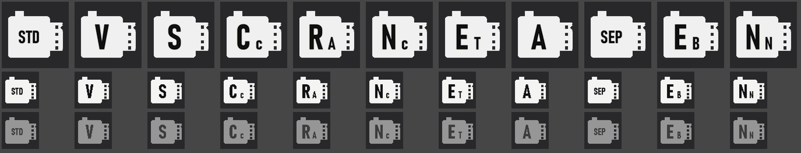

# FAUXJI for the Samsung TL500 (EX1)

**Quality-of-life fixes the TL500 should have shipped with: an exposure system that stops fighting you, unlocked menus, auto-ISO in
manual and a tilt tag that rotates your sideways shots. Plus a set of optional Fuji-style extras.**

It is a **build tool**, not a firmware download: it patches *your own* copy of Samsung's official firmware on your own computer.
Nothing of Samsung's is included in this repository.

> **Not affiliated with Samsung or Fujifilm.** Fujifilm's film names (PROVIA, Velvia, ACROS, Classic Chrome and so on) are their
> trademarks. They are used here only to say which look each setting imitates.
> **Flash at your own risk.** See [Safety](#safety) first. You are changing the software of a camera that is out of production.

Current version: **TL-F59**, built on firmware **008264** only.

## The main event: fixes that make the camera better to use

- **Shutter that stays usable.** In P, A and S the slowest shutter stays at 1/60 s. Zooming in no longer pushes it up to 1/125 s
  or faster, and the flash no longer raises it either. Stock, the camera quietly raised the minimum as you zoomed.
- **Auto-ISO in manual.** Manual mode gets automatic ISO, so you set shutter and aperture and the camera picks the ISO.
- **Highlight-friendly metering.** Metering is biased -0.3 EV in every mode, so skies and lamps blow out less. The exposure scale
  still reads 0.
- **Menus open in P, A, S and M.** In those modes every menu option is available. Stock, some were greyed out depending on the mode.
- **Tilt tag.** The camera has no tilt sensor, so vertical shots always came out sideways. Now it writes the EXIF orientation:
  from faces looking sideways, or (Auto+) from where the sky or the ceiling light is in the live-view brightness. The VIDEO button
  cycles Off, Auto, Auto+, always right, always left, and an arrow on the shooting screen shows what it will do. Auto+ is a guess and
  can be fooled by lamps and windows, so rotate in playback when it is wrong.
- **Looks work with RAW+JPEG.** The looks Samsung blocked when you shoot RAW+JPEG now work, and Bleach Bypass saves at full size.

## The extras: Fuji-style looks and interface

If you like the Fuji feel, the same build also has these. They come with the fixes for now; a switch to leave them out is the next thing
planned (see Coming up).

- **Film looks.** Eleven Fuji-style looks in the Photo Style slots (PROVIA, ACROS, Classic Chrome, Classic Neg., Velvia, ASTIA, Eterna,
  Sepia and more): colour, tone curves and per-hue colour tuned for this sensor, in live view and in captured JPEGs.
- **FILM SIM button.** The AE-L button menu gets a FILM SIM option that cycles your looks, with a film-canister icon and a name pop-up.
- **Fuji-style interface.** Flat white icons, and Fuji-style menus, shooting screen, mode dial, pop-ups, playback edit screens, boot
  screen, shutter sound and menu names (Image Quality, AE-L Button, Framing Guide and so on).



*The canister icons the camera shows for each look (selected, small, and unselected). Drawn for this project.*

## Coming up

Development is paused for a few days and should pick up again around the end of the week. Next on the list, no promises on order:

- **Pick what you want.** Separate options for the fixes and the Fuji extras, so you can take just the fixes (the main point) and
  leave the looks and the new interface out, or the other way round.
- **Film camera mode.** The SCENE spot on the mode dial becomes a film-camera mode: a simpler screen with a big roll counter, no
  picture review after each shot, a film-stock picker in place of the scene picker, and the front scroll wheel winding the film
  between shots. This one needs a few test builds, so it will take a while.
- **Smaller ideas:** custom recipe slots with ready-made looks, the film look shown in playback, an orange film-style date stamp.

Ideas and bug reports are welcome in the issue tracker.

## What you need

1. A Samsung TL500 / EX1 running the official firmware **008264**, and an SD card.
2. The official firmware files for that version, unmodified. Their SHA-256 must be:

   | File | SHA-256 |
   |---|---|
   | `EX1-DSP-SR-008264.elf` | `53a17829c71a7ab1609dbafe2371f23fc6f0a49e4dcba35028d82946106c626b` |
   | `SPID.Rom` | `28da03005858e5bda32ae7761acb2634ab4b13b651177b1d7b36c7622393b928` |
   | `ONBL1.bin` | `5a5b4e99a3f7f9a83ead297b842e0019a656a1a977db7dcc96acd8ad77a00b20` |
   | `ONBL2.bin` | `d3c558c7fbc793c3cae9aef707e6ab0d9f24c8fdda65e2eeab12f36feafac703` |
   | `FWUP` | `9ded3061aeb5f25ae36e5d17ce935549632933ba041515ad90dfcf9115f92036` |

   Get them from Samsung's own update package for your camera. This project cannot and does not host them. The build stops
   if any hash differs.
3. Python 3.9 or newer, then `pip install -r requirements.txt` (Pillow, NumPy, Capstone).
4. A TrueType font for the artwork. On Windows, Bahnschrift is found automatically. On other systems set `FAUXJI_FONT` to a
   DIN-style font such as Barlow or D-DIN, or put one at `tools/fonts/font.ttf`. A different font changes the artwork
   slightly and the output will not be byte-identical to the author's builds.

## Build

Put the five stock files in a folder, for example `stock/`, then:

```bash
python tools/build_fauxji.py stock out
```

`out/` now holds the five files for the SD card. Anything Samsung-owned in them was made from your copy on your machine.
The bootloader files (`ONBL1.bin`, `ONBL2.bin`) and `FWUP` are copied unchanged.

## Flash

1. Charge the battery fully. Put the five files in the **root** of a freshly formatted SD card.
2. Put the card in the camera and switch it on. Samsung's update screen appears (a blue "FW Version" screen showing
   `DSC: FULL <current> -> <new>`). Start the update as Samsung's own firmware instructions for the TL500 describe.
3. Do not switch the camera off or remove the battery until it finishes. Remove the card afterwards.

The camera's version screen should now read **TL-F59**.

## Safety

- This changes the camera's main program and its resources. It does **not** change the bootloader. The author has flashed
  dozens of builds on one camera without a brick, and going back by flashing Samsung's official files was tried and works.
  That is one person's experience, not a guarantee. If a build misbehaves, put the official files on the card and flash them again.
- Everything here was found by reading the firmware. Several spots are best-effort and verified only on one camera. Expect
  rough edges and report them.
- The patch routines check that the bytes they change are what they expect, so a wrong firmware version stops the build
  instead of producing something odd.
- Read [docs/TEST-PLAN.md](docs/TEST-PLAN.md) for the cautious way to approach this, including recovery paths.

## For developers

- `tools/build_fauxji.py`: the build. `tools/fauxji.py` (looks, exposure), `tools/fauxji_ui.py` (FILM SIM button, pop-ups),
  `tools/fauxji_rot.py` (tilt tag, menu unlock, small hooks), `tools/fauxji_layout.py`, `tools/fuji_menu.py`, `tools/fuji_lv.py`,
  `tools/fauxji_playback.py` (interface artwork), `tools/badges.py`, `tools/bootscreen.py`, `tools/sounds.py`.
- `python tools/test_sky.py` runs the tilt-tag machine code in a tiny ARM interpreter against a Python reference.
- [docs/RESEARCH-LOG.md](docs/RESEARCH-LOG.md) is the long, chronological log of how everything was found.
  [docs/FEATURES.md](docs/FEATURES.md) has the status of each feature and where the code lives, and
  [docs/ROADMAP.md](docs/ROADMAP.md) the ideas that are left.
- Research helpers such as `match_funcs.py`, `fuzzy_match.py` and `liveness.py` expect your stock files and the firmware of a
  related camera under `extracted/`, which is not part of this repository.

## License

MIT, see [LICENSE](LICENSE). The license covers the tools and patches in this repository only. Samsung's firmware is Samsung's.
